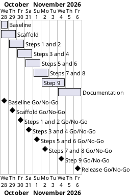

# Project Plan: Snack and Lift Booking Bot

## Metadata
| Key | Value |
| --- | --- |
| ID | PP-001 |
| CrossReference | [BC-001], [SA-001], [MIL-001], [MIL-002], [MIL-003], [MIL-004], [MIL-005], [MIL-006], [MIL-007], [MIL-008] |
| Language | en |
| Domain | it |

## Version History
| Date | Status | Author | Reviewer | Change | Commit |
| --- | --- | --- | --- | --- | --- |
| 2026-10-28 | Accepted | Jens Tirsvad Nielsen | S01 | Initial version: eight gateways | [50e8331] |

---

## Purpose

This plan schedules eight gateways (`MIL-001` to `MIL-008`) that take the Snack and Lift booking bot from an accepted baseline to a documented, tested and published repository. The Business Case sets no deadline, so the window 2026-10-28 to 2026-11-06 is a planning assumption of this plan. Each gateway ends in a decision and a deliverable and is delivered by one pull request on its own branch.

## Planning Assumptions

- Week 1 starts 2026-10-28; the plan ends by 2026-11-06 (a planning assumption, see Open Issues).
- Phase length: one to two days per gateway. Gateways 003 to 007 follow the Udemy lecture steps 1 to 9.
- One branch and one pull request per gateway, each closing the issues of its tasks.
- The user stories and use case steps of the journey are skipped for this project (ADR-0001), so no gateway lists stories.
- Autonomous mode: S01 accepts this plan in chat; the AI acts as stand-in reviewer (S02) and records it in each `RC-*`.

## Gateway Schedule

| Gateway | Document | Window | Decision date | Owner | Stories | Main deliverable | Milestone |
| --- | --- | --- | --- | --- | --- | --- | --- |
| Baseline and repository set-up | [MIL-001] | 2026-10-28 | 2026-10-28 | S01 | none (documents) | Accepted baseline, ADRs, repository description and topics | |
| Project scaffold and tooling | [MIL-002] | 2026-10-28 to 2026-10-29 | 2026-10-29 | S01 | none (technical tasks) | `pyproject.toml`, layout, `.gitignore`, Doxyfile, README, Docker image | |
| Lecture steps 1 and 2 | [MIL-003] | 2026-10-29 to 2026-10-30 | 2026-10-30 | S01 | none (technical tasks) | Chrome profile, navigation, `login()`, screenshots 1 and 2 | |
| Lecture steps 3 and 4 | [MIL-004] | 2026-10-30 to 2026-10-31 | 2026-10-31 | S01 | none (technical tasks) | Card parsing, booking, state checks, screenshots 3 and 4 | |
| Lecture steps 5 and 6 | [MIL-005] | 2026-10-31 to 2026-11-01 | 2026-11-01 | S01 | none (technical tasks) | Counters, summary, Tuesday and Thursday list, screenshots 5 and 6 | |
| Lecture steps 7 and 8 | [MIL-006] | 2026-11-01 to 2026-11-02 | 2026-11-02 | S01 | none (technical tasks) | My Bookings verification, time travel, screenshots 7 and 8 | |
| Lecture step 9 | [MIL-007] | 2026-11-02 to 2026-11-04 | 2026-11-04 | S01 | none (technical tasks) | `retry`, resilient `login`, `book_class`, `get_my_bookings`, screenshot 9 | |
| Documentation, wiki and release | [MIL-008] | 2026-11-04 to 2026-11-06 | 2026-11-06 | S01 | none (documentation) | README, Doxygen, wiki in en, da and ms, final checks | |



## Scope Coverage

| Business Case scope item | Gateway |
| --- | --- |
| Selenium bot for the practice site, with the assignment's function names | MIL-003, MIL-004, MIL-006, MIL-007 |
| Lecture steps 1 to 9 | MIL-003 (1, 2), MIL-004 (3, 4), MIL-005 (5, 6), MIL-006 (7, 8), MIL-007 (9) |
| Python project files: `src/`, `tests/`, `docs/`, `pyproject.toml`, `constants.py`, `.gitignore`, Doxyfile, README | MIL-002, MIL-008 |
| Unit tests with `pytest` | MIL-002 to MIL-007 |
| One screenshot per lecture step in README and wiki | MIL-003 to MIL-007 (capture), MIL-008 (use) |
| Wiki in en, da and ms | MIL-008 |
| Repository description and topics | MIL-001 |

## Dependencies

```
MIL-001 → MIL-002 → MIL-003 → MIL-004 → MIL-005 → MIL-006 → MIL-007 → MIL-008
```

A No-Go on a gateway stops all later gateways until it is fixed and re-reviewed. The end date then moves by the days spent on the rework; S01 decides a move of the end date.

## Plan Risks

| Risk | Impact | Mitigation |
| --- | --- | --- |
| The practice site changes its page structure (Business Case risk: site changes) | Steps 3 to 9 need rework | Selectors only in `constants.py`; the first task of MIL-003 records the page as seen |
| The container starts with an empty site database (state lives in the browser profile) | Login and booking cannot be shown | MIL-003 registers a documented test account in a profile volume; browser runs reset data through the admin page |
| Stand-in review misses a defect | Defect reaches `main` | `RC-*` marks the review as not independent; S01 reviews the final summary |
| Translations take longer than planned | MIL-008 slips | Write English first; da and ms follow page by page; no extra pages |

## Open Issues

- Target repository: the user names `https://git.tirsystem.com/Tirsvad-Udemy-100_days_of_code`, but `origin` is `Tirsvad-Udemy-100-days-of-code/049-snack-and-lift`. The plan uses `origin` (description and topics are set there) until S01 states otherwise in chat.
- The Business Case sets no deadline; the window 2026-10-28 to 2026-11-06 is this plan's own assumption.
- No QC checklist exists for accepting the Project Plan beyond `QC-PP-001`; S01's acceptance of the plan in chat accepts the row.

---

[BC-001]: ./business-case.md
[SA-001]: ./stakeholder-analysis.md
[MIL-001]: ./milestones/mil-001-baseline.md
[MIL-002]: ./milestones/mil-002-scaffold.md
[MIL-003]: ./milestones/mil-003-login.md
[MIL-004]: ./milestones/mil-004-book-class.md
[MIL-005]: ./milestones/mil-005-counters-and-both-days.md
[MIL-006]: ./milestones/mil-006-verify-and-time-travel.md
[MIL-007]: ./milestones/mil-007-resilience.md
[MIL-008]: ./milestones/mil-008-documentation.md
[50e8331]: https://git.tirsystem.com/Tirsvad-Udemy-100-days-of-code/049-snack-and-lift/commit/50e8331bd21910a72ae56b74c9ff6a3677a709b3
